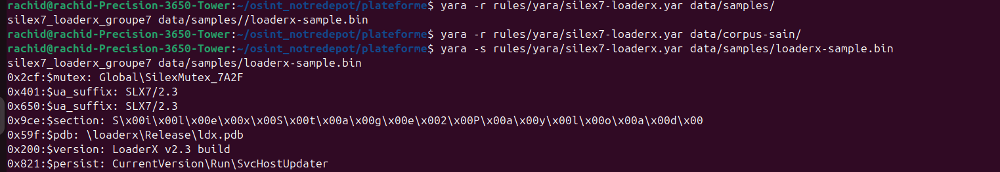
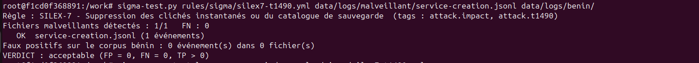
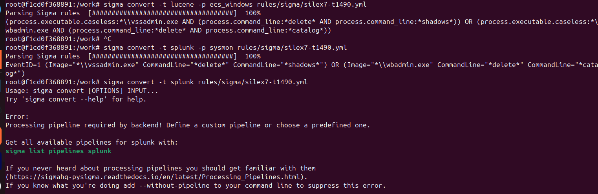

# TP3 — Réponses

## A1. Exploitation du rapport (IT320-TR-2026-03, SILEX-7 / LoaderX)

### IoC

| Type | Valeur | Rôle |
|---|---|---|
| sha256 | 4a40e42c6e880884906a6629e9077950d0c76c31566c351b0ebe4ef177ef94b6 | LoaderX v2.3 |
| sha256 | e2fa6d7d5f7fb9cdf6da75e743e46335b017cf0ca925ee70a723170222738df4 | Document Word piégé (dropper) |
| sha256 | ce4e403d6a434c66be9a9768ddfeaed916d25f01fd5d80f96358c76d811b9270 | rclone renommé `svchost64.exe` |
| domaine | silex-update.example | Téléchargement de LoaderX |
| domaine | cdn-metrics-sync.example | C2 et exfiltration |
| IP | 203.0.113.77 | Résout cdn-metrics-sync.example |
| IP | 198.51.100.23 | Serveur RDP relais |

### Artefacts

| Type | Valeur | Remarque |
|---|---|---|
| Mutex | `Global\SilexMutex_7A2F` | Instance unique de LoaderX, stable sur les 3 échantillons |
| User-Agent | `Mozilla/5.0 (Windows NT 10.0; Win64; x64) SLX7/2.3` | Seul le suffixe `SLX7/2.3` est spécifique, le préfixe Mozilla est générique |
| Clé de registre | `HKCU\Software\Microsoft\Windows\CurrentVersion\Run\SvcHostUpdater` | Persistance au démarrage, pointe vers une copie dans `%APPDATA%` |
| Chemin PDB | `C:\dev\loaderx\Release\ldx.pdb` | Laissé à la compilation |
| Chaîne UTF-16 | `SilexStage2Payload` | Nom de la section mémoire de la charge de 2e étape |
| Chaîne de version | `LoaderX v2.3 build 0417` | Change à chaque version |
| Commande | `powershell.exe -nop -w hidden -enc <base64>` | Lancée par la macro Word |
| Commande | `wmic /node:<hôte> process call create` | Exécution distante |
| Commande | `vssadmin.exe delete shadows /all /quiet` | Suppression des clichés instantanés |
| Commande | `wbadmin delete catalog -quiet` | Suppression du catalogue de sauvegarde |
| Binaire | rclone renommé `svchost64.exe` | Exfiltration vers stockage objet |

### TTP (mapping de l'éditeur, annexe)

| Étape | Technique | ID |
|---|---|---|
| Accès initial | Spearphishing Attachment (ZIP protégé, Word à macro ou .lnk) | T1566.001 |
| Exécution | User Execution : Malicious File | T1204.002 |
| Exécution | PowerShell (`-enc`, `-w hidden`) | T1059.001 |
| Mouvement latéral | Windows Management Instrumentation (`wmic /node`) | T1047 |
| Mouvement latéral | Remote Desktop Protocol | T1021.001 |
| Exfiltration | Exfiltration to Cloud Storage (rclone) | T1567.002 |
| Impact | Inhibit System Recovery (vssadmin, wbadmin) | T1490 |
| Impact | Data Encrypted for Impact (GPO ou PsExec) | T1486 |

### Durable ou jetable (pyramide de la douleur)

- **Jetable (bas de la pyramide)** : les 3 hash (il suffit de changer un octet), les 2 IP (changer de serveur), les 2 domaines (en racheter un autre). Utiles pour une recherche rapide, inutiles contre la variante suivante.
- **Intermédiaire (artefacts)** : mutex, suffixe `SLX7/2.3`, clé `SvcHostUpdater`, PDB, `SilexStage2Payload`. Pour les changer, il faut modifier le code et recompiler. Le rapport les dit stables sur les 3 échantillons, ce qui en fait une bonne base pour une règle YARA. La chaîne de version et le User-Agent complet sont moins durables.
- **Durable (haut de la pyramide : outil et TTP)** : l'outil LoaderX lui-même et les comportements (PowerShell encodé lancé par Word, WMI distant, suppression des sauvegardes avant chiffrement, exfiltration par rclone renommé). SILEX-7 loue son ransomware à plusieurs programmes RaaS : la charge de chiffrement change, mais la chaîne d'attaque reste la même. Ce sont donc les comportements qu'il faut détecter en priorité (règles Sigma).

## A2. Règle YARA — `rules/yara/silex7-loaderx.yar`

### Principe
La règle décrit LoaderX par ses **artefacts** : des chaînes écrites dans le binaire par le développeur, stables sur les 3 échantillons d'après le rapport (sections 4 et 6). La condition `uint16(0) == 0x5A4D` limite la recherche aux exécutables Windows (en-tête `MZ`), et `3 of them` impose au moins 3 chaînes sur 6 pour éviter les faux positifs.

### Chaînes retenues
| Variable | Chaîne | Type | Dans l'exemple de l'enseignant ? |
|---|---|---|---|
| `$mutex` | `Global\SilexMutex_7A2F` | ascii | oui |
| `$ua_suffix` | `SLX7/2.3` | ascii | oui |
| `$section` | `SilexStage2Payload` | **wide** (UTF-16) | oui |
| `$pdb` | `\loaderx\Release\ldx.pdb` | ascii nocase | **non, ajoutée** |
| `$version` | `LoaderX v2.3 build` | ascii | **non, ajoutée** |
| `$persist` | `CurrentVersion\Run\SvcHostUpdater` | ascii nocase | **non, ajoutée** |

Chaînes volontairement écartées car trop génériques : `Mozilla/5.0` seul, `Global\` seul, l'en-tête `MZ` seul (pièges du corpus sain).

### Tests
- `yara -r rules/yara/silex7-loaderx.yar data/samples/` → `loaderx-sample.bin` uniquement : **TP = 1/1**
- `yara -r rules/yara/silex7-loaderx.yar data/corpus-sain/` → aucun résultat : **FP = 0/~60**
- `yara -s` sur l'échantillon : **6 chaînes sur 6** trouvées (la règle n'en demande que 3), `SLX7/2.3` présente 2 fois, `SilexStage2Payload` bien trouvée en UTF-16.

### Comparaison avec l'exemple de l'enseignant
L'exemple utilise 3 chaînes avec `2 of them` : si l'attaquant en modifie 2, la règle ne détecte plus rien. Notre règle utilise 6 chaînes avec `3 of them` : elle détecte encore si l'attaquant en modifie jusqu'à 3. Elle résiste donc mieux à une nouvelle version de LoaderX, sans faux positif sur le corpus sain.

### Position dans la pyramide de la douleur
Niveau intermédiaire (artefacts et outil). Ces chaînes résistent à un changement de hash, d'IP ou de domaine, mais pas à une réécriture du code de LoaderX. `$version` est la chaîne la moins durable : elle changera à la v2.4.

## A3. Règle Sigma — `rules/sigma/silex7-t1490.yml`

### Choix de la technique
T1490 (Inhibit System Recovery) : avant le chiffrement, SILEX-7 lance `vssadmin.exe delete shadows /all /quiet` puis `wbadmin delete catalog -quiet` (rapport, section 3, étape 6) pour empêcher la victime de restaurer ses fichiers.
- On n'a pas pris T1059.001, déjà traité par l'exemple de l'enseignant.
- C'est un comportement durable (haut de la pyramide de la douleur) : tout ransomware doit supprimer les sauvegardes, quel que soit le chargeur ou la charge louée.
- Il produit peu de faux positifs : supprimer tous les clichés est rare en exploitation normale.

### Logique de la règle
- `logsource` : `process_creation` / `windows` (Sysmon EventID 1).
- `selection_vssadmin` : `Image` se termine par `\vssadmin.exe` ET `CommandLine` contient `delete` et `shadows`.
- `selection_wbadmin` : `Image` se termine par `\wbadmin.exe` ET `CommandLine` contient `delete` et `catalog`.
- `condition: 1 of selection_*` : OU entre les deux comportements.
- Des mots-clés plutôt que la commande exacte, pour couvrir les variantes d'options (`/for=`, ordre différent). `delete` est exigé pour ne pas alerter sur `vssadmin list shadows` (consultation légitime).
- Métadonnées : `tags: attack.impact, attack.t1490`, `level: high`, `falsepositives` (admin ou script de maintenance qui purge les clichés).

### Test
`sigma-test.py rules/sigma/silex7-t1490.yml data/logs/malveillant/service-creation.jsonl data/logs/benin/`
- Fichiers malveillants détectés : 1/1 (1 événement, la ligne vssadmin ; la ligne `sc.exe create`, qui relève d'une autre technique, n'est pas visée)
- **TP = 1, FN = 0, FP = 0** → **VERDICT : acceptable**

### Conversions
Elastic / OpenSearch (`-t lucene -p ecs_windows`) :
    (process.executable.caseless:*\\vssadmin.exe AND (process.command_line:*delete* AND process.command_line:*shadows*)) OR (process.executable.caseless:*\\wbadmin.exe AND (process.command_line:*delete* AND process.command_line:*catalog*))

Splunk (`-t splunk -p sysmon`) :
    EventID=1 (Image="*\\vssadmin.exe" CommandLine="*delete*" CommandLine="*shadows*") OR (Image="*\\wbadmin.exe" CommandLine="*delete*" CommandLine="*catalog*")

Sans `-p`, sigma-cli refuse (« Processing pipeline required by backend ») : sans pipeline, il ne sait pas comment s'appellent les champs dans le SIEM cible, et la requête risquerait de ne rien trouver sans aucune erreur.

### Que fait le pipeline `ecs_windows` aux noms de champs ?
Il renomme les champs Sysmon de la règle vers le schéma ECS d'Elastic : `Image` → `process.executable.caseless` (comparaison insensible à la casse) et `CommandLine` → `process.command_line`. Le pipeline `sysmon` pour Splunk, lui, garde les noms d'origine mais traduit le `logsource` `process_creation` en condition `EventID=1`.

## A4. Mapping ATT&CK manuel (liste fermée `prompts/candidats-attack.txt`)

| Action décrite dans le rapport | Technique | Annexe éditeur |
|---|---|---|
| Archive ZIP contenant un Word à macro ou un .lnk (§3.1) | T1566.001 | oui |
| Ouverture du fichier piégé par l'utilisateur (§3.2) | T1204.002 | oui |
| `powershell.exe -nop -w hidden -enc` (§3.2) | T1059.001 | oui |
| Téléchargement de LoaderX depuis silex-update.example (§3.2) | T1105 | **non** |
| Commande en base64, charge de 2e étape chiffrée (§3.2, §4) | T1027 | **non** |
| Clé `HKCU\...\Run\SvcHostUpdater` (§3.3) | T1547.001 | **non** |
| `wmic /node:<hôte> process call create` (§3.4) | T1047 | oui |
| Vol d'identifiants en mémoire (§3.4) | T1003.001 | **non** (déduction : LSASS non nommé) |
| Connexions RDP avec comptes admin (§3.4) | T1021.001 | oui |
| Requêtes HTTP de LoaderX vers le C2 avec User-Agent `SLX7/2.3` (§4) | T1071.001 | **non** |
| rclone renommé vers stockage objet (§3.5) | T1567.002 | oui |
| `vssadmin delete shadows`, `wbadmin delete catalog` (§3.6) | T1490 | oui |
| Chiffrement déployé par GPO ou PsExec (§3.6) | T1486 | oui |

**Liste retenue (13)** : T1566.001, T1204.002, T1059.001, T1105, T1027, T1547.001, T1047, T1003.001, T1021.001, T1071.001, T1567.002, T1490, T1486.

**Non retenues** : T1036 (rclone renommé en `svchost64.exe`) est hors liste. T1021.002 et T1570 (PsExec) ne sont pas cochées, car le rapport ne décrit pas le mécanisme. T1059.003 (`cmd.exe`) est visible dans les logs mais absente du rapport.

**Qu'ajouterions-nous ?** T1547.001 (la persistance est décrite précisément, clé comprise, mais elle n'a pas d'identifiant dans l'annexe), T1105, T1027, T1071.001 et T1003.001.

**Que retirerions-nous ?** Rien : les 8 techniques de l'annexe sont toutes justifiées par le texte. T1204.002 recouvre en partie T1566.001, mais ATT&CK distingue l'envoi de la pièce jointe et son ouverture par l'utilisateur.

**Par rapport à l'annexe** : rappel 8/8 = 100 %, précision 8/13 = 62 %. La précision est pénalisée par des ajouts pourtant justifiés : l'annexe de référence est elle-même incomplète.