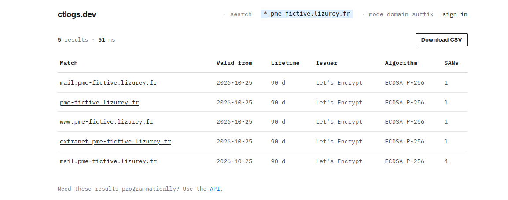
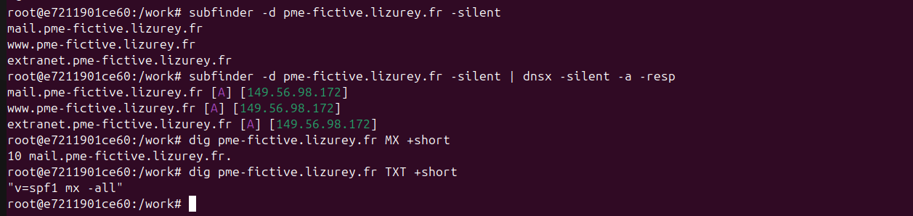
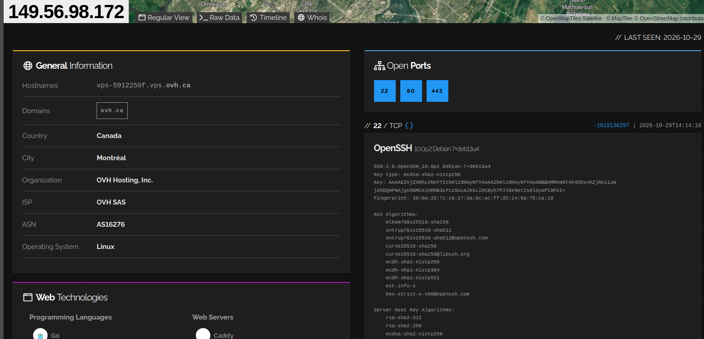
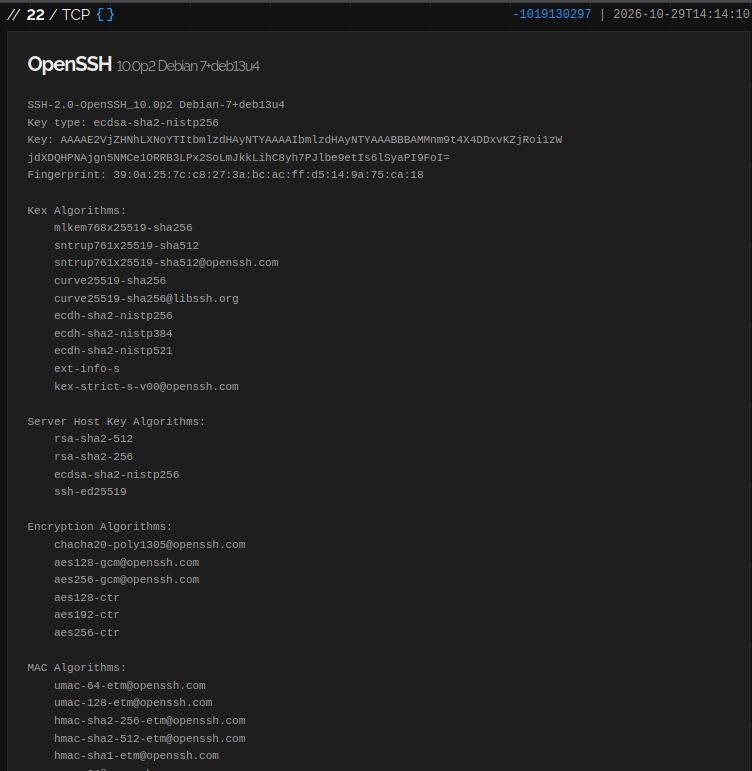
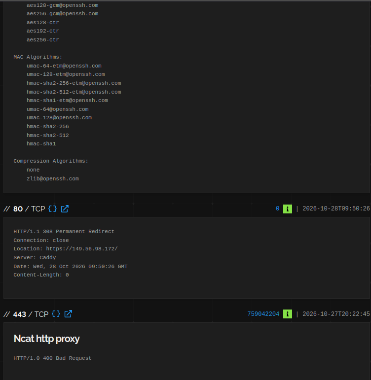
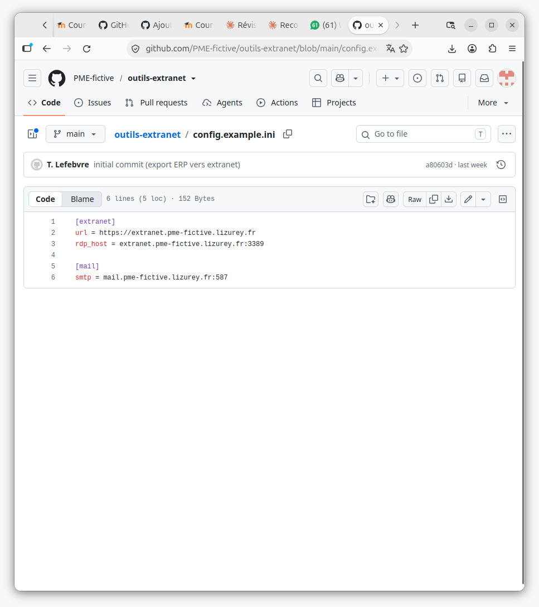
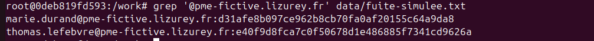
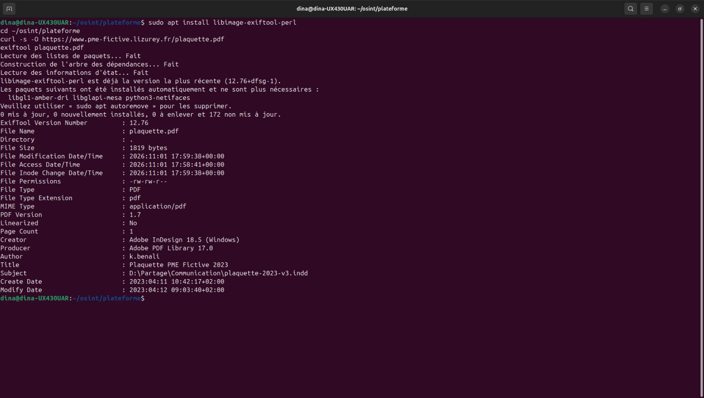
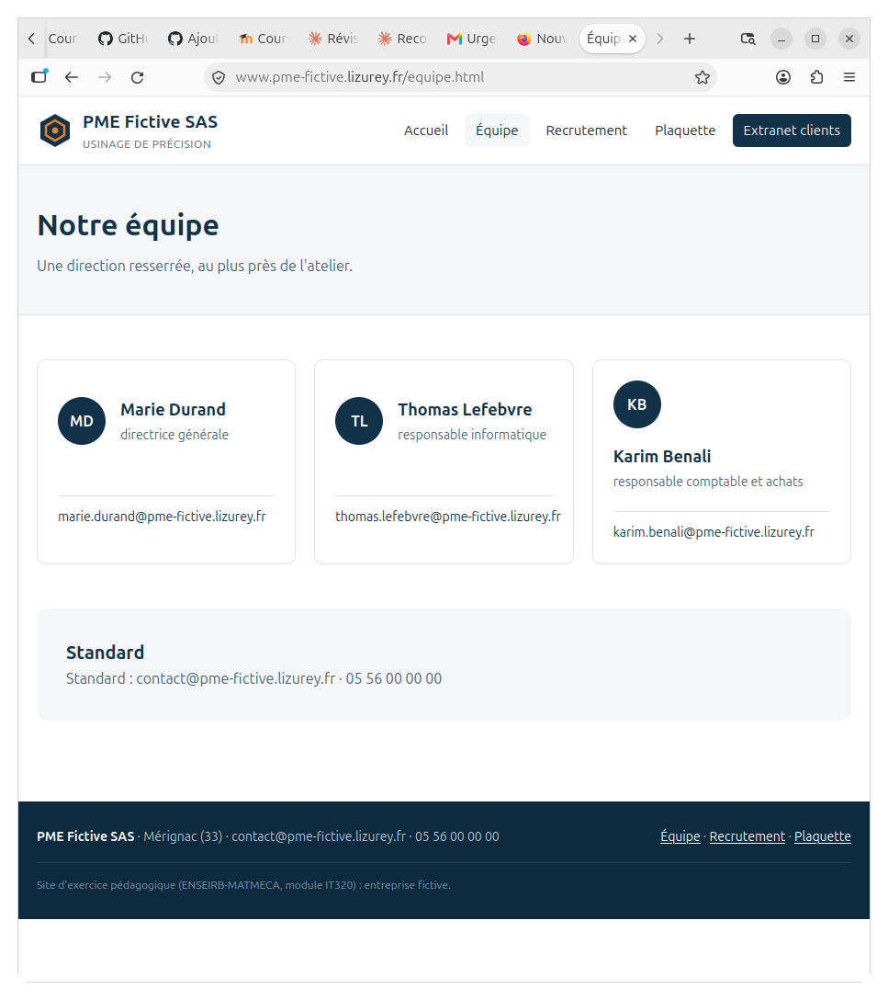
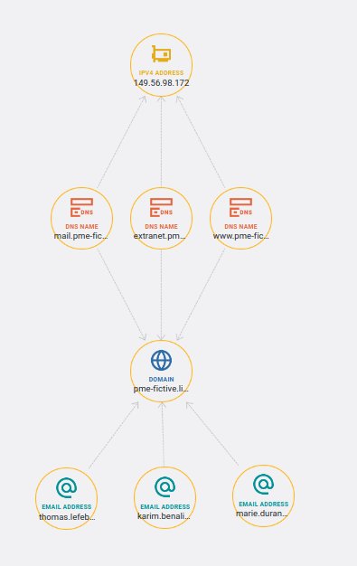

# Surface d'attaque exposée — PME Fictive SAS (fictive) — TLP:AMBER — 2026-11-02

**Marquage TLP:AMBER** : la fiche décrit des faiblesses exploitables et des identifiants exposés d'une organisation nommée ; diffusion limitée à la PME et au CERT.

Cible : PME Fictive SAS, usinage de précision (aéronautique, médical), 120 salariés, Mérignac (33). Périmètre autorisé : `*.pme-fictive.lizurey.fr`. Domaine créé le 25/10/2026.

## 1. Synthèse

PME Fictive SAS expose quatre noms (racine, www, extranet, mail), tous hébergés sur un seul VPS OVH (149.56.98.172). Le responsable informatique a publié sur un dépôt GitHub public une clé API de production et un mot de passe de base de données en clair (constat 1, priorité critique). Son adresse et celle de la directrice générale figurent dans une fuite avec empreinte de mot de passe, et le format des identifiants internes se déduit des documents publics (constat 2, haute). Tous les services, dont l'extranet clients et la messagerie, reposent sur une même machine dont SSH est ouvert sur Internet (constat 3, haute). **Risque global : élevé.** Aucun identifiant ni secret n'a été testé, et aucune action active n'a été menée hors du bac à sable.

## 2. Périmètre identifié

| Nom | IP | Services | Technologies | Source | Confiance |
|---|---|---|---|---|---|
| pme-fictive.lizurey.fr | 149.56.98.172 | MX, SPF | Certificat Let's Encrypt 25/10/2026 → 23/01/2027 ; MX `mail.` ; SPF `v=spf1 mx -all` | ctlogs.dev, dig | A1 |
| www.pme-fictive.lizurey.fr | 149.56.98.172 | 443 (80 → 443) | Site vitrine ; plaquette PDF (InDesign 18.5, Windows) | ctlogs.dev, dig, site web | A1 |
| extranet.pme-fictive.lizurey.fr | 149.56.98.172 | 443 | Portail de connexion clients, hôte interne « EXTRANET-SRV », API `/api/v1/import` ; RDP 3389 prévu (non observé) | ctlogs.dev, dig, theHarvester, site web, GitHub | A1 (RDP : B3) |
| mail.pme-fictive.lizurey.fr | 149.56.98.172 | (25 non observé) | Messagerie auto-hébergée (MX) ; Zimbra selon l'offre d'emploi ; SMTP 587 selon le dépôt GitHub | ctlogs.dev, dig, theHarvester, site web, GitHub | A1 (Zimbra : B2) |

**Au niveau de l'IP** (serveur Linux, OVH, Montréal) : Shodan voit 22/tcp (OpenSSH 10.0p2 Debian), 80/tcp (Caddy, redirection 308 vers HTTPS) et 443/tcp (réponse 400 Bad Request, identifié comme « Ncat HTTP proxy »). Aucune CVE suggérée, ce qui ne garantit pas l'absence de vulnérabilité. La réponse 400 s'explique par un reverse proxy : Shodan interroge l'IP sans nom d'hôte et ne voit donc pas ce que chaque sous-domaine sert. La Wayback Machine ne révèle aucun ancien sous-domaine.

**Figure 1 — Certificat Let's Encrypt couvrant 4 noms (ctlogs.dev)**

**Figure 2 — Résolution DNS des sous-domaines**

**Figure 3 — Shodan : informations générales sur 149.56.98.172**

**Figure 4 — Shodan : SSH exposé (port 22)**

**Figure 5 — Shodan : HTTP et HTTPS (ports 80 et 443)**

## 3. Constats par ordre de priorité

**C1 (critique). Secrets de production en clair dans un dépôt GitHub public.**
*Vu :* le dépôt public `github.com/pme-fictive/outils-extranet` (un commit `a80603d`, auteur T. L***, responsable informatique) contient dans `export_erp.py` une clé API de production (`pmf_live_7f3a***`), l'URL de l'API d'import de l'extranet, et le compte de base de données `erp_export` / `Export2***` sur l'IP interne 10.20.0.15. Le fichier `config.example.ini` mentionne un accès RDP `extranet…:3389`. Le README précise « Ne pas diffuser ».
*Risque :* la clé vise un service joignable depuis Internet ; elle permettrait vraisemblablement d'injecter ou de modifier des données de l'extranet clients. Le mot de passe de la base n'est pas utilisable directement (adresse privée), mais son format faible (mot + année + caractère) laisse craindre une réutilisation. Le dépôt donne aussi une partie du plan d'adressage interne.
*Source :* https://github.com/pme-fictive/outils-extranet, consulté le 2026-11-01.
*Recommandation :* révoquer la clé API et changer le mot de passe `erp_export` aujourd'hui ; rendre le dépôt privé puis purger l'historique (le secret a pu être copié) ; sortir les secrets du code (variables d'environnement, coffre-fort) et activer la détection de secrets (GitHub secret scanning, gitleaks).

**Figure 6 — Secrets en clair dans export_erp.py, dépôt public pme-fictive/outils-extranet (valeurs masquées)**

**C2 (haute). Comptes clés dans une fuite, format des identifiants connu.**
*Vu :* m.d***@ (directrice générale) et t.l***@ (responsable informatique) figurent dans la fuite simulée avec une empreinte de mot de passe de 40 caractères hexadécimaux (format compatible SHA-1). Les adresses suivent la convention `prenom.nom@`, et les métadonnées de la plaquette révèlent un login Windows au format `initiale.nom` (`k.b***`).
*Risque :* le responsable informatique est l'auteur de C1 et a probablement des droits d'administration. Avec la liste des noms de la page Équipe et le format des logins, un attaquant peut construire des identifiants Active Directory valides et tenter une pulvérisation de mots de passe sur l'extranet, la messagerie ou l'accès distant. La directrice est une cible naturelle d'arnaque au président.
*Source :* `plateforme/data/fuite-simulee.txt` ; https://www.pme-fictive.lizurey.fr/equipe.html ; métadonnées de https://www.pme-fictive.lizurey.fr/plaquette.pdf.
*Recommandation :* réinitialiser les mots de passe des deux comptes sur tous les services (AD, Zimbra, extranet, VPN) ; imposer la MFA en commençant par l'accès distant, la messagerie et l'extranet ; bloquer les mots de passe du type « Mot+Année+! » dans la politique AD. Nous n'avons pas testé les identifiants ni cassé les empreintes.

**Figure 7 — Adresses de la PME dans la fuite simulée (empreintes masquées)**

**Figure 8 — Métadonnées de la plaquette : login de l'auteur et chemin interne**

**C3 (haute). Tous les services sur un seul serveur, extranet et administration exposés.**
*Vu :* site vitrine, extranet et messagerie partagent un unique serveur (149.56.98.172) ; SSH (22) est ouvert sur Internet ; l'extranet est un portail de connexion clients doté d'une API, et le dépôt GitHub y prévoit un RDP (non visible dans Shodan).
*Risque :* aucune séparation entre services : la faille la plus faible met en danger tous les autres, messagerie comprise. L'extranet est l'hôte le plus intéressant pour un attaquant, car il concentre authentification, API (clé exposée en C1) et accès distant. SSH et RDP exposés sont des cibles classiques de force brute, d'autant plus avec des identifiants fuités (C2). Bloquer l'IP d'un attaquant ne le gênerait pas, il en change en quelques minutes (bas de la Pyramid of Pain) ; fermer les accès d'administration et cloisonner les services lui retire ses points d'entrée et l'oblige à changer de technique.
*Source :* https://www.shodan.io/host/149.56.98.172 ; dig ; https://extranet.pme-fictive.lizurey.fr ; GitHub.
*Recommandation :* limiter SSH aux IP d'administration (ou au VPN) avec authentification par clé ; ne jamais exposer RDP, le placer derrière le VPN FortiGate avec MFA ; protéger l'extranet par MFA et limitation des tentatives ; séparer à terme la messagerie et l'extranet du site vitrine.

**C4 (moyenne). Informations internes publiées par la PME elle-même.**
*Vu :* l'offre d'emploi du 12/09/2026 détaille le parc (Windows 10/11, Windows Server 2016/2019, AD, ERP Sage, Zimbra, FortiGate 60F, Veeam, RDP pour les commerciaux) ; la plaquette contient le chemin `D:\Partage\Communication\` et le login de son auteur ; la page de connexion de l'extranet affiche le nom d'hôte interne « EXTRANET-SRV ».
*Risque :* un attaquant sait quels produits viser, quelles vulnérabilités chercher et comment habiller un phishing crédible.
*Source :* https://www.pme-fictive.lizurey.fr/recrutement.html ; plaquette.pdf (exiftool) ; https://extranet.pme-fictive.lizurey.fr.
*Recommandation :* rédiger les offres sans noms de produits ni versions ; nettoyer les métadonnées avant toute publication (`exiftool -all=`) ; retirer les noms internes des pages publiques.

**Point positif.** Le SPF `v=spf1 mx -all` est strict : seul le serveur de messagerie peut envoyer au nom du domaine, ce qui limite l'usurpation d'adresse. À compléter par DKIM et DMARC (non vérifiés).

## 4. Personnes et identifiants exposés

| Adresse | Fonction | Où | Dans la fuite |
|---|---|---|---|
| m.d***@pme-fictive.lizurey.fr | Directrice générale | page Équipe | oui |
| t.l***@pme-fictive.lizurey.fr | Responsable informatique | pages Équipe et Recrutement, auteur du dépôt GitHub | oui |
| k.b***@pme-fictive.lizurey.fr | Responsable comptable et achats | page Équipe, auteur de la plaquette (login `k.b***`) | non |
| contact@pme-fictive.lizurey.fr | Adresse générique | pied de page | non |

Convention des adresses : `prenom.nom@`. Convention probable des logins Windows : `initiale.nom`. theHarvester ne trouve aucune adresse (domaine trop récent pour être indexé) : seule la lecture du site les révèle. Recommandation : voir C2 ; remplacer les adresses nominatives du site par des adresses de fonction (`direction@`, `rh@`, `recrutement@`) ; sensibiliser la direction et la comptabilité à l'arnaque au président et aux fausses factures ; surveiller le domaine sur Have I Been Pwned.

**Figure 9 — Page Équipe : adresses nominatives publiées**

## 5. Ce que nous n'avons pas fait et pourquoi

- Aucun identifiant testé, aucune empreinte cassée, aucune utilisation de la clé API ou du mot de passe trouvés : ce serait un accès frauduleux (art. 323-1 du code pénal), interdit par la charte même sur une cible fictive.
- Aucun scan de ports : les services listés viennent de Shodan (passif). Le RDP 3389 et le port 25 ne sont donc ni confirmés ni infirmés.
- nuclei (partie A7, bonus) non exécuté faute de temps : les technologies réellement servies derrière le reverse proxy ne sont pas confirmées.
- Domaine trop récent pour les moteurs : theHarvester ne trouve aucune adresse, les dorks Google ne renvoient rien. crt.sh était indisponible, remplacé par ctlogs.dev.
- LinkedIn non consulté en mode connecté (charte). Le domaine parent `lizurey.fr` est hors périmètre et n'a pas été étudié.
- Maltego en plan Basic : 24 résultats par transformation et sources limitées.

## 6. Journal de bord (annexe)

| Horodatage | Action | Outil | Source | Résultat | Cotation |
|---|---|---|---|---|---|
| 2026-11-02 [heure] | Recherche des certificats | ctlogs.dev (crt.sh indisponible) | https://ctlogs.dev/search?q=pme-fictive.lizurey.fr | racine, www, extranet, mail ; Let's Encrypt, valide jusqu'au 23/01/2027 | A2 |
| 2026-11-02 [heure] | Résolution des sous-domaines | dig | DNS public | 4 noms → 149.56.98.172 | A1 |
| 2026-11-02 [heure] | Requêtes MX et TXT | dig | DNS public | MX mail.pme-fictive.lizurey.fr ; SPF v=spf1 mx -all | A1 |
| 2026-11-02 [heure] | Archives | Wayback Machine | https://web.archive.org | aucun ancien sous-domaine | A2 |
| 2026-11-02 [heure] | Exposition de l'IP | Shodan | https://www.shodan.io/host/149.56.98.172 | OVH Montréal ; 22 OpenSSH 10.0p2, 80 Caddy (308), 443 (400, Ncat proxy) ; aucune CVE | B2 |
| 2026-11-01 17:25 | Page Équipe | navigateur | https://www.pme-fictive.lizurey.fr/equipe.html | 3 adresses nominatives + contact@ ; convention prenom.nom@ | A1 |
| 2026-11-01 17:26 | Offre d'emploi | navigateur | https://www.pme-fictive.lizurey.fr/recrutement.html | AD, Sage, Zimbra, FortiGate 60F, Veeam, RDP | A1 |
| 2026-11-01 17:27 | Page extranet | navigateur | https://extranet.pme-fictive.lizurey.fr | portail de connexion, hôte « EXTRANET-SRV » | A1 |
| 2026-11-01 17:28 | Croisement avec la fuite | grep | plateforme/data/fuite-simulee.txt | m.d***@ et t.l***@ avec empreinte | F3 (fuite) / A1 (présence) |
| 2026-11-01 17:31 | Adresses et hôtes | theHarvester 4.11.1 | crtsh, duckduckgo, hackertarget | 0 adresse ; extranet et mail → 149.56.98.172 | A2 |
| 2026-11-01 17:48 | Recherche GitHub par domaine | GitHub | https://github.com/search?q=pme-fictive.lizurey.fr&type=code | uniquement des copies du dépôt du cours, écartées | A2 |
| 2026-11-01 17:55 | Analyse du dépôt de la PME | navigateur | https://github.com/pme-fictive/outils-extranet | clé API live, compte BDD, IP 10.20.0.15, RDP 3389 prévu | A1 |
| 2026-11-01 [heure] | Dorks | Google | filetype:pdf ; "…" password ; intitle:"index of" | aucun résultat (domaine non indexé) | A2 |
| 2026-11-01 18:00 | Métadonnées de la plaquette | exiftool 12.76 | https://www.pme-fictive.lizurey.fr/plaquette.pdf | auteur k.b*** ; D:\Partage\Communication\ ; InDesign 18.5 Windows ; 11/04/2023 | A1 |
| 2026-11-02 [heure] | Carte de la surface d'attaque | Maltego Graph (Basic) | transformations passives | graphe domaine → noms → IP → netblock + adresses | A2 |

## 7. Carte de la surface d'attaque (annexe)

Légende :
1. Le domaine au centre ; tous les noms convergent vers une seule IP, 149.56.98.172 : un seul serveur porte site, extranet et messagerie.
2. L'IP appartient au bloc d'un hébergeur (OVH) : une compromission ou une panne de ce serveur touche tous les services d'un coup.
3. Les adresses fuitées se rattachent au même domaine que l'extranet et la messagerie : c'est le chemin le plus court d'un identifiant fuité vers un accès.